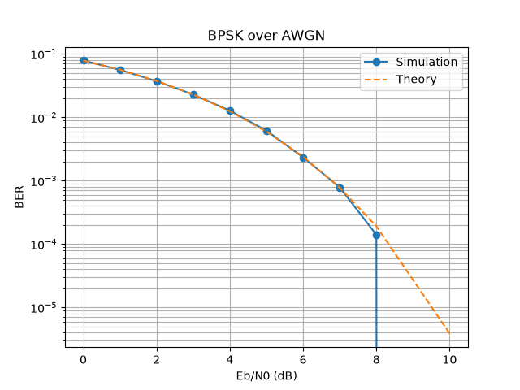

# BPSK over AWGN: BER Simulation in Python

A simulation of a simple digital communication chain in Python: random bits are modulated with **BPSK**, sent through an **AWGN** (additive white Gaussian noise) channel, and recovered by a threshold receiver. The simulated **bit error rate (BER)** is compared with the exact theoretical BER.



## Overview

The project answers one question: *how does the bit error rate change as the signal gets cleaner compared to the noise?*

```
random bits -> BPSK modulation -> AWGN channel -> threshold receiver -> count errors
```

## How it works

1. **Generate bits.** Each bit is randomly 0 or 1.
2. **BPSK modulation.** Bit 0 is mapped to -1 and bit 1 to +1 (`signal = 2 * bit - 1`).
3. **AWGN channel.** Gaussian noise with standard deviation `sigma` is added to the signal. `sigma` is derived from the chosen Eb/N0:

   `sigma = sqrt(1 / (2 * Eb/N0))`

4. **Receiver decision.** If the received value is above 0, the receiver decides 1, otherwise 0.
5. **Count errors.** BER = number of wrong bits / total bits.
6. **Repeat** for several Eb/N0 values (in dB) and plot BER on a logarithmic scale.

## Theory

For BPSK over an AWGN channel, the exact bit error rate is:

`BER = 0.5 * erfc( sqrt(Eb/N0) )`

where `erfc` is the complementary error function and Eb/N0 is the energy per bit divided by the noise power spectral density (as a plain ratio, not in dB). The conversion from dB is `ratio = 10^(dB / 10)`.

## Results

- The simulated points fall on the theoretical curve, which validates the simulation.
- BER decreases as Eb/N0 increases, because a stronger signal relative to the noise means the noise rarely pushes a symbol across the decision threshold.
- With very high noise the BER approaches 0.5, which is equivalent to random guessing, and it never goes above that.
- At high Eb/N0 the BER becomes very small, so many bits are needed for a reliable estimate. With too few bits, some points show zero errors and cannot be drawn on a log scale.

## Parameters

| Parameter | Value | Meaning |
|---|---|---|
| `total` | 200000 | Bits simulated per Eb/N0 value |
| `ebn0_db_list` | 0 to 8 dB | Signal quality levels tested |

Increase `total` (for example to 2,000,000) to measure lower BERs more accurately, at the cost of a longer run time.

## How to run

Requirements: Python 3.8 or later.

```
pip install matplotlib
python bpsk_ber.py
```

The script prints the simulated BER for each Eb/N0 value, shows the plot, and saves it as `ber_curve.png`.

## Project structure

```
.
├── bpsk_ber.py     # simulation and plotting
├── ber_curve.png   # resulting plot
└── README.md
```

## What I learned

- How a digital communication chain works end to end: modulation, channel, receiver decision.
- What noise does to a signal, and why a stronger signal-to-noise ratio gives fewer errors.
- How to measure BER with a Monte Carlo simulation, and why a large number of bits is needed.
- How to convert between dB and plain ratios, and why engineers use a logarithmic scale for BER plots.
- How to validate a simulation by comparing it with theory.
- Python skills: loops, conditions, lists, `random`, `math`, and plotting with `matplotlib`.

## Possible next steps

- Add QPSK and 16-QAM and compare their BER curves with BPSK.
- Add an error-correcting code (for example Hamming) and measure the coding gain.
- Replace the AWGN channel with a Rayleigh fading channel.
- Package the project in a Docker container.

